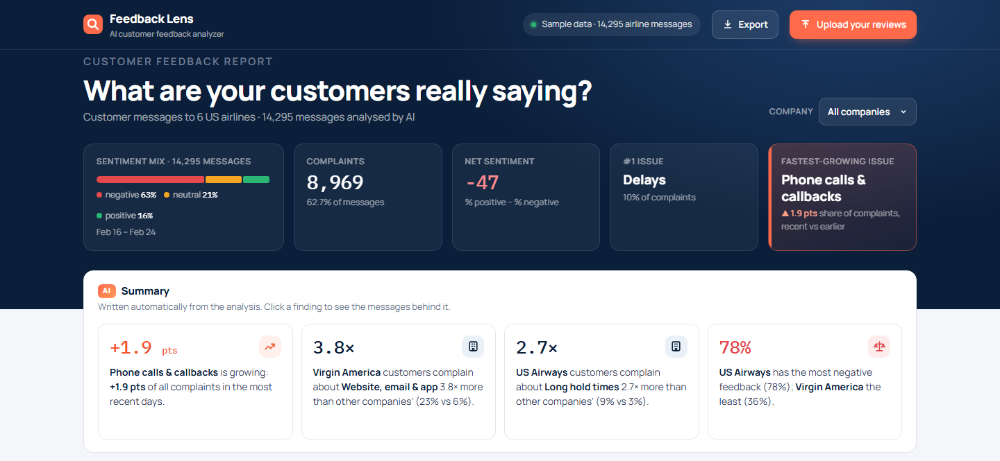
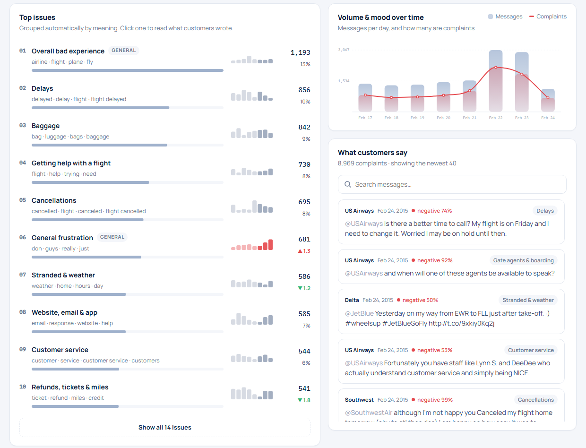
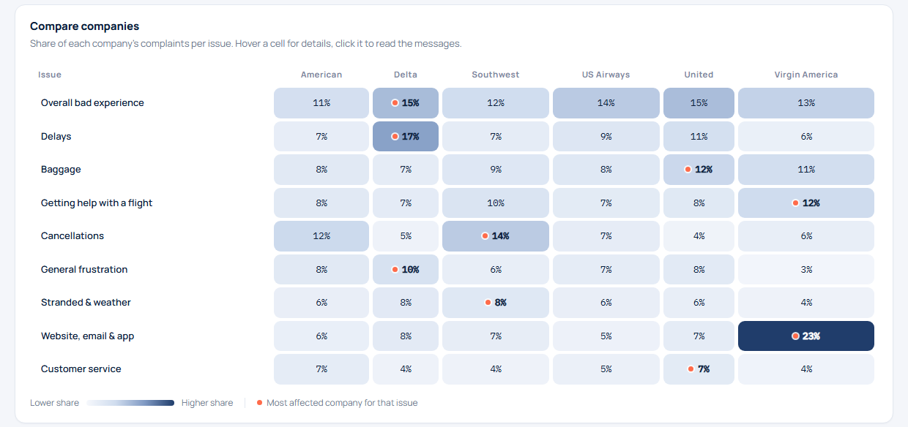

# 🔍 Feedback Lens: AI customer feedback analyzer

**Thousands of customer reviews, read in a minute. What customers love, what they complain about, which problems are growing, and what they actually wrote.**

### ▶ [Try it live: feedback-lens-omega.vercel.app](https://feedback-lens-omega.vercel.app)

You upload a file of reviews, and an AI dashboard tells you the story behind them. Everything runs in your browser, so customer data never leaves your computer.



## What it answers

| A manager asks… | Feedback Lens shows… |
|---|---|
| "How are we doing?" | Sentiment mix, number of complaints, net sentiment |
| "What should we fix first?" | The **#1 fixable issue**, and every issue ranked by size |
| "What's getting worse?" | The **fastest-growing issue**, and a trend for every issue |
| "Is one branch or product worse than the others?" | A company comparison table, plus AI-written findings like *"Virgin America customers complain about its website 3.8× more than other airlines"* |
| "Show me real examples" | The actual customer messages behind every number, with search that tolerates typos |





**Upload your own reviews:** drop in a CSV file. The text, date and company columns are detected automatically, and the analysis runs **in the browser** (about a minute for 1,000 reviews). Rename any issue in one click, then export the results to CSV or print a report.

## How it works

### 1. Sentiment: a fine-tuned transformer
A DistilBERT model fine-tuned on 11,500 labelled customer messages reads each one as negative, neutral or positive.

| Model | Accuracy | Macro F1 |
|---|---:|---:|
| Always say "negative" | 62.7% | — |
| Word counting (TF-IDF + logistic regression) | 78.3% | 72.1% |
| BERT-mini, 11M parameters | 78.6% | 72.9% |
| **DistilBERT, 67M parameters (used)** | **82.9%** | **77.7%** |

*Scores on 1,399 test messages the models never saw.* The small model barely beat word counting here, so the app uses DistilBERT only, compressed to 8-bit to run in the browser.

### 2. Issues: found automatically, no list given in advance
Each complaint becomes an **embedding**, 384 numbers that capture its meaning (all-MiniLM-L6-v2). Complaints with close meanings are grouped with k-means, and each group is named from its most distinctive words. Because nobody tells the AI which topics exist, it works on any business: restaurants, shops, apps, hotels.

Checked against the human complaint labels it never saw, grouping by **meaning** agrees about **twice as well** as grouping by **words** (ARI 0.127 vs 0.061, NMI 0.246 vs 0.183). It's also more useful than the human labels: the labellers put 2,880 complaints into one "Customer Service Issue" bucket, while the AI split them into fixable problems like *long hold times*, *phone calls & callbacks* and *refunds & miles*.

### 3. Insights: written by the app
The AI summary compares every issue across companies and over time, and writes the findings as sentences. Each finding links to the messages behind it.

## Problems I found and fixed along the way

- **A data leak.** The dataset's text had been edited so that "cancel" read "Cancelled Flight" and "late" read "Late Flight", which are the names of the complaint categories. A model would "find" those topics by reading the labels. I reversed the edit before training.
- **A headline that pointed at nothing.** The biggest group was general venting ("worst airline ever"). The headline numbers now only consider specific, fixable issues.
- **Messy topics on small uploads.** Tiny groups are merged into their nearest topic, and topics sharing their main keyword are combined. I first measured merging by meaning distance, but it would have merged *delays* with *cancellations*, which a manager needs kept apart.
- **Trend lines that lied.** Raw daily counts made every issue spike on busy days, so the mini charts show each issue's share of the day's complaints instead.

## Limits

- **English only.** Sarcasm can fool the sentiment model.
- **Topic names on uploads are suggestions** (rename them), and k-means starts randomly, so two runs can group slightly differently.
- **Uploads are capped at 2,000 reviews** to keep the browser responsive.

## Run it yourself

The dashboard needs no install. Serve the `demo/` folder:

```
python -m http.server 8000 --directory demo
```

To rebuild the models and the sample analysis:

```
python -m venv .venv
.venv\Scripts\python.exe -m pip install torch --index-url https://download.pytorch.org/whl/cu126
.venv\Scripts\python.exe -m pip install transformers datasets scikit-learn sentence-transformers matplotlib onnx onnxruntime
```

| Script | What it does |
|---|---|
| `00_download.py` | Downloads the airline messages, fixes the label leak, splits the data |
| `01_explore.py` | Sentiment mix, complaints per airline, complaint reasons |
| `02_baseline.py` | Word-counting sentiment baseline |
| `03_sentiment.py mini` / `distilbert` | Fine-tunes a sentiment transformer |
| `04_topics.py` | Embeddings, clustering, naming, and comparison with human labels |
| `05_evaluate_export.py` | Test scores, 8-bit ONNX export, downloads the browser embedding model |
| `06_build_demo.py` | Pre-analyses the sample data for the dashboard |

## Built with

Python · PyTorch · Hugging Face Transformers · Sentence-Transformers · scikit-learn · ONNX Runtime · Transformers.js · Papa Parse · plain HTML, CSS and JavaScript

## Credits

- Sample data: [Twitter US Airline Sentiment](https://huggingface.co/datasets/osanseviero/twitter-airline-sentiment) (CrowdFlower / Figure Eight "Data for Everyone"), **CC BY-NC-SA 4.0**: non-commercial use. For client work, the tool is used on the client's own reviews.
- Models: [DistilBERT](https://huggingface.co/distilbert-base-uncased) and [BERT-mini](https://huggingface.co/google/bert_uncased_L-4_H-256_A-4) (Apache 2.0), [all-MiniLM-L6-v2](https://huggingface.co/sentence-transformers/all-MiniLM-L6-v2) (Apache 2.0).
